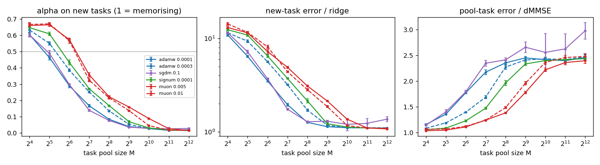

# Research log: Muon vs AdamW and in-context learning

Newest entry on top. Each run gets one entry: what ran, what came out, what it means, and
what happens next. Engineering detail (job IDs, fixes, cluster issues) is kept out of this
file and lives in `../optimizer-icl-home/memory/STATUS.md`. The design and the fallback ladder are in `PLAN.md`.

How to read the numbers:
- **Error on new tasks** is the mean squared error on prompts whose w was never in training,
  after 15 examples. It is shown next to its ratio to ridge regression, the best possible
  answer: "1.00x" means the model is doing optimal in-context regression.
- **Error on pool tasks** is the same measure on prompts whose w came from the training
  pool. It is compared with dMMSE, the best possible answer for a model that memorises the pool.
- **alpha** places the model between the two: about 1 means it behaves like a pool memoriser,
  about 0 means it does real regression. It only means something once the model is close
  to one of them, so ignore it in the first few hundred steps.
- **ICL onset** is the step where new-task error has fallen halfway from where it started
  to ridge.

## Where we are

| | |
|---|---|
| Stage | Runs 1-4 are done and analysed (Run 3 and question 3 on 2026-11-11). All three proposal questions are answered. Left: the robustness run (Run 5 in PLAN.md), the mechanism follow-ups, and the write-up. |
| Examples needed (question 3) | **With enough tasks (2,048 or more), the optimizer makes no difference**: with 15 examples, both models are as accurate as optimal regression with about 14. With fewer tasks, Muon's models get less out of each example (at 256 tasks: worth 8 examples vs AdamW's 12.5; 6 of 6 seeds, p = 0.031). |
| Main finding | **At the same number of training steps, Muon memorises the task pool more and sooner, so it needs 2-3x more distinct tasks than AdamW before in-context learning wins** (6 of 6 seeds, every learning-rate pairing, p = 0.031, the smallest possible with 6 seeds). With 2,048 or more tasks the two end up the same. |
| Long training (Run 3) | **Muon is roughly AdamW on a 4x faster clock.** Over 300,000 steps both thresholds keep rising at the same pace, and AdamW reaches each threshold about 4x later than Muon. In-context learning fades at every pool size for both optimizers. Muon peaks 3-4.5x sooner and starts fading 4-5x sooner (4 of 4 seeds). |
| Why | **Both halves of Muon's update speed up memorisation** (Runs 4 and 4b). Signum, which equalises step sizes but doesn't orthogonalise, lands between AdamW and Muon at both learning rates tried; SGD lands on AdamW. Orthogonalisation adds 0.5-0.7 doublings on top of Signum (6 of 6 seeds in every pairing). Like Muon's, and unlike AdamW's, Signum's threshold barely moves with learning rate. |
| Open questions | Why ICL onset speeds up only 1.3-2.5x while memorisation speeds up about 4x. |

---

## Run 5: robustness to learning rate and weight decay (planned 2026-11-11, not launched)

**What:** 288 runs of 30,000 steps in three batches, each covering every pool size from 16 to
1,024 plus infinite, with seeds 0-5. Every run is paired seed by seed with Run 2.
- **5a (first):** AdamW one learning-rate step up (1e-3) and Muon one step down (0.0025).
- **5b:** weight decay for both, set so each optimizer's weights shrink by the same amount per
  step: AdamW 3e-4 with 0.1, Muon 0.005 with 0.006. Equal settings would shrink Muon's weights
  17x faster, because the shrink scales with the learning rate.
- **5c:** AdamW one step down (3e-5) and Muon one step up (0.02).

**Why:** the main finding compares two hand-picked learning rates per optimizer. AdamW's
threshold rises with its learning rate (28 tasks at 1e-4, 41 at 3e-4), so the obvious objection
is that a higher AdamW learning rate would catch up with Muon. 5a tests that directly, which is
why it runs first. Weight decay is the standard lever on whether in-context learning fades, and
Muon is normally run with it.

**What would change the story:** the decision rules are fixed in PLAN.md ("Run 5 design")
before any result.
- If AdamW 1e-3 still sits below Muon 0.0025 in 6 of 6 seeds, the threshold gap survives
  tuning.
- If AdamW 1e-3 catches up, the finding becomes "Muon acts like AdamW at a higher learning
  rate". That fits Run 3's faster-clock reading and is still reportable.
- With weight decay, the question is whether the gap holds (6 of 6 seeds) and whether decay
  slows the fade for either optimizer.

**What the results will look like:** the Run 2 threshold table with up to eight learning rates
instead of four, a paired test for each pairing, and a version of the threshold-against-pool-size
figure with every learning rate on it. A second table will show weight decay against Run 2's
matching runs.

**Cost:** at Run 2's pace (about 80 minutes per run, 70 at a time), each batch takes 2-3 hours.
On 2026-11-11 the cluster's CPU queue was 93% full, with room for only about 5 runs at once, so a
batch launched then could take a day.

---

## Question 3: how many in-context examples each model needs (analysis, 2026-11-11)

**What:** no new training. The error on new tasks at every context length (0 to 15 examples in
the prompt) was already recorded at every evaluation. This analysis compares it with ridge
regression on the same prompts, at the end of Run 2 (all optimizers, 6 seeds) and over
training in Run 3. Script: `scripts/examples_needed.py`. Tables:
`reports/q3_examples_needed_run02.md` and `reports/q3_examples_needed_run03.md`.

**The three measures:**
- **Excess error** (planned): the area between the model's error-vs-examples curve and
  ridge's, as the average gap over k = 0..15. 0 means optimal at every prompt length.
- **Examples to match ridge** (planned, with one change): the smallest k after which the model
  stays within 10% of ridge. Read literally, the plan's wording is always k = 0: with no
  examples every predictor guesses about 0 and all errors are about 8.1. So the condition
  has to hold from k on.
- **Ridge-equivalent examples** (added after looking, as a readable summary): with 15
  examples in the prompt, the model is as accurate as optimal regression with this many. 15
  means it gets full value from every example.

**Result:** once there are enough tasks the optimizer makes no difference. Below that, Muon's
models get less out of each example.

Ridge-equivalent examples at the end of Run 2 (out of 15, mean of 6 seeds):

| Pool size | SGD 0.1 | AdamW 1e-4 | AdamW 3e-4 | Signum 1e-4 | Muon 0.005 | Muon 0.01 |
|---|---|---|---|---|---|---|
| 32 | 4.6 | 5.0 | 3.3 | 2.6 | 2.1 | 2.0 |
| 128 | 10.7 | 10.1 | 7.9 | 7.3 | 6.2 | 6.6 |
| 256 | 12.6 | 12.5 | 10.9 | 9.6 | 8.0 | 8.3 |
| 512 | 12.6 | 13.4 | 13.2 | 12.6 | 9.6 | 10.3 |
| 1,024 | 12.6 | 13.7 | 13.7 | 13.4 | 12.2 | 13.3 |
| 2,048 | 12.5 | 13.8 | 13.8 | 13.8 | 13.8 | 13.8 |
| infinite | 10.9 | 14.0 | 13.8 | 14.0 | 14.1 | 13.9 |

- **With 2,048 or more tasks, both optimizers make about equally good use of the examples.**
  With 15 examples, each is as accurate as optimal regression with about 14. Excess error is
  0.04-0.06, against ridge errors from 8.1 (no examples) to 0.55 (15 examples). Between AdamW and
  Muon the difference is at most 0.013. At Muon 0.005 that small difference favours Muon in 6
  of 6 seeds. At Muon 0.01 it goes either way.
- **With 1,024 or fewer tasks, Muon's models fall further behind ridge** in all four
  learning-rate pairings, 6 of 6 seeds, p = 0.031 every time. At 256 tasks, a Muon model shown
  15 examples does about as well as optimal regression shown 8. AdamW 1e-4 does as well as
  optimal regression shown 12.5. Signum and SGD fall in the same order as their thresholds.
- **The gap grows with the number of examples.** With 128 or more tasks, every model is within
  about 10% of ridge for the first 2 examples. The memorising models fall behind as examples are added because they don't extract
  the full value of each new example (figure: `reports/figs/run02/examples_needed.png`).
- **The "examples to match ridge" measure doesn't work here.** Even the best models end at
  1.07-1.09x ridge at 15 examples, right at the 10% line, so the measure mostly records which
  side of 1.10 the last position happens to land on. It flips between 0 and 13 across seeds
  and settings. The table is in the report, but it shouldn't be quoted.

Over training (Run 3), ridge-equivalent examples follow the same rise and fall as Run 3's
fading. At 1,024 tasks, AdamW peaks at 13.7 (step 37,000) and Muon at 13.3 (step 9,100). At
128 tasks the peaks are 11.1 and 10.6. Muon's best is reached about 4x sooner and is slightly
lower. These are means of 4 seeds, not paired-tested. By step 300,000 both have dropped, for
example to 11.1 and 9.8 at 1,024 tasks. Figure: `reports/figs/run03/examples_needed_over_time.png`.

**What it means:** this answers the proposal's question 3. The optimizer doesn't change how
efficiently a model that has learned in-context regression uses its examples: with enough
tasks, AdamW and Muon get about 14 examples' worth out of 15. Everything Muon changes shows up
through memorisation. Where a Muon model memorises more (fewer tasks, or the same number of
steps), it also gets less out of each example in the prompt.

---

## Run 4b: Signum at a second learning rate (2026-11-03, 20:10-22:05 PT)

**What:** 60 runs: Signum at 3e-4, every pool size, seeds 0-5, paired with everything above.

**Why:** AdamW's threshold rises with its learning rate (28 tasks at 1e-4, 41 at 3e-4) and
Muon's doesn't. Run 4 tried Signum at one learning rate only. If Signum's threshold rises at
3e-4 too, the "equal step sizes" share of Muon's effect shrinks, and orthogonalisation carries
more of it.

**What the results will look like:** one more row in the Run 4 threshold table and paired
tests against AdamW 3e-4 and Muon.

**Result:** Signum's threshold hardly moves with learning rate, and Muon stays clearly above it.
All 60 runs finished.

| Optimizer | Threshold at the lower / higher learning rate |
|---|---|
| AdamW (1e-4 / 3e-4) | 28 / 41 tasks |
| Signum (1e-4 / 3e-4) | 50 / 54 tasks |
| Muon (0.005 / 0.01) | 80 / 77 tasks |

Paired tests with Signum at 3e-4 (6 of 6 seeds agree and p = 0.031 in every row):

| Comparison | Threshold moves by |
|---|---|
| Signum 3e-4 vs AdamW 3e-4 | +0.41 doublings |
| Muon 0.005 vs Signum 3e-4 | +0.58 doublings |
| Muon 0.01 vs Signum 3e-4 | +0.52 doublings |

What this says:
- **Orthogonalisation raises the threshold on its own, whichever learning rate Signum uses.**
  Across all four Signum/Muon pairings, Muon is 0.5-0.7 doublings (1.4-1.6x more tasks) above
  Signum.
- **Equal step sizes also raise it**, by 0.4 doublings at a matched learning rate (3e-4 for both).
- **AdamW is the odd one out.** For both optimizers that give equal-size steps (Signum and Muon),
  the learning rate barely changes the threshold. For AdamW it changes it by 0.56 doublings.
- **Caveat:** 3e-4 is the most Signum can take. With 2,048 or more tasks, and in one of six seeds
  at 512, it trained and then blew up. Its threshold (near 54 tasks) comes from smaller pools,
  where it trained normally. So Signum can't be pushed to a higher learning rate to close the
  gap with Muon.

Figure (now with Signum 3e-4 as the dashed green line): `reports/figs/run04/vs_pool_size_all.png`.

---

## Run 4: Signum and SGD across every pool size (2026-11-03, 18:10-20:00 PT)

**What:** 120 runs: Signum at 1e-4 and SGD with momentum at 0.1 (the Run 4a picks), pool
sizes 16 to 4,096 plus infinite, seeds 0-5, 30,000 steps. Each run uses the same task pool,
starting weights and batches as the matching Run 2 run, so all four optimizers can be paired
seed by seed.

**Why:** to find which part of Muon makes it memorise more. Muon normalises each update and
orthogonalises it. Signum keeps the normalisation only, SGD keeps neither. If Signum's
threshold sits with Muon's, normalisation is enough; if it sits with AdamW's,
orthogonalisation is the cause.

**What the results will look like:** the Run 2 threshold table with two more rows (pool size
where each optimizer switches to ICL, per seed), paired tests of Signum and SGD against both
AdamW and Muon, and the same error-versus-pool-size figure with four lines.

**Result:** Signum lands between AdamW and Muon, and SGD lands on AdamW. All 120 runs finished.

Pool size where each optimizer switches from memorising to in-context learning (6 seeds each):

| Optimizer | What its update does | Threshold (tasks) |
|---|---|---|
| SGD 0.1 | neither | 30 |
| AdamW 1e-4 / 3e-4 | per-entry scaling by gradient noise | 28 / 41 |
| Signum 1e-4 | every entry gets the same size step | 50 |
| Muon 0.005 / 0.01 | same size step in every direction of the matrix (orthogonalised) | 80 / 77 |

Paired tests, seed by seed (6 of 6 seeds agree and p = 0.031 in every row; a "doubling"
is a 2x change in the threshold):

| Comparison | Threshold moves by |
|---|---|
| Signum vs AdamW 1e-4 | +0.84 doublings |
| Signum vs AdamW 3e-4 | +0.29 doublings |
| Muon 0.005 vs Signum | +0.70 doublings |
| Muon 0.01 vs Signum | +0.64 doublings |
| SGD vs AdamW 1e-4 | +0.10 doublings (p = 0.16, no real difference) |

What this says:
- **The orthogonalisation is a cause on its own.** Signum already equalises step sizes. Muon
  equalises them across the matrix's directions instead of its entries, and that alone raises the
  threshold by about 0.7 doublings (1.6x more tasks) at both Muon learning rates.
- **Equal step sizes add some memorisation too, but how much depends on AdamW's learning
  rate**: 0.84 doublings against AdamW 1e-4, only 0.29 against 3e-4. Run 4b settles this:
  at a matched learning rate (3e-4) the gap is 0.41 doublings.
- **How Adam scales steps doesn't matter here.** Plain SGD with momentum behaves like AdamW
  1e-4 wherever it trains well. (SGD is weaker with 1,024 or more tasks, 1.2-1.4x ridge
  against AdamW's 1.1x, and one SGD seed trained badly with an infinite pool. Neither affects
  the threshold, which sits near 30 tasks.)
- **The weight-change measure from Run 2 lines up, with one exception.** At pool sizes where
  the models memorise, the spread of each optimizer's weight changes (effective rank of the
  change, attention / MLP) goes AdamW 45-53 / 78-86, Signum 62-65 / 86-90, Muon 66-77 / 109-114.
  That is the same order as the thresholds. SGD breaks it: its spread is the lowest of all
  (30-37 / 36-50), yet it memorises like AdamW. So spreading the update over more directions
  goes with more memorisation, but it is not the whole explanation.

Full tables: `reports/run04_compare.md` and `reports/figs/run04/*/stats.md`.

---

## Run 4a: calibration for the ablation optimizers (2026-11-03, 16:20-18:05 PT)

**What:** 14 runs, seed 0, 30,000 steps, pool size inf and 64. Signum (sign of the momentum: every
update the same size per entry, but *not* orthogonalised) at 1e-4, 3e-4 and 1e-3. SGD with
momentum (neither normalised nor orthogonalised) at 0.03, 0.1, 0.3 and 1.0.

**Why:** Muon does two things to an update: it normalises its size, and it orthogonalises it
(spreads it evenly over all directions). Signum keeps the first and drops the second. If
Signum also memorises more than AdamW, orthogonalisation is not the cause.

**What the results will look like:** the same table as Run 1. It gives one good learning rate per
ablation optimizer for Run 4, the full pool-size sweep with those two optimizers added.

**Result:** both optimizers have a learning rate that trains as well as tuned AdamW and Muon.

With an infinite pool (every prompt a fresh task):

| Optimizer | Learning rate | Error on new tasks (vs ridge) |
|---|---|---|
| Signum | 1e-4 | 0.578 (1.07x) |
| Signum | 3e-4 | 0.690 (1.28x) |
| Signum | 1e-3 | trained to 0.63, then diverged after step 16,500 |
| SGD | 0.03 | 0.602 (1.11x) |
| SGD | 0.1 | 0.587 (1.09x) |
| SGD | 0.3, 1.0 | never learned |
| *Run 2, same seed:* AdamW 1e-4 / Muon 0.005 | | *1.08x / 1.08x* |

Picks for Run 4: **Signum 1e-4, SGD 0.1.**

A first look at the "why" question from the 64-task pool (one seed, so a hint and nothing more):

| Optimizer | Error on new tasks (vs ridge) | Error on pool tasks (vs dMMSE) |
|---|---|---|
| AdamW 1e-4 | 3.5x | 1.87x |
| SGD 0.1 | 3.7x | 1.74x |
| Signum 1e-4 | 6.4x | 1.23x |
| Muon 0.005 | 7.7x | 1.08x |

Signum memorises nearly as much as Muon, and SGD behaves like AdamW. If Run 4 confirms this,
orthogonalisation is not what makes Muon memorise. The cause would be something Muon and
Signum share and AdamW does not: every part of the weight matrix gets a step of the same size,
however small or noisy its gradient. Adam shrinks steps where the gradient is noisy. Figures:
`reports/figs/run04a/`.

---

## Run 3: long training (2026-11-03 16:20 PT to 2026-11-04 21:46 PT)

**What:** 40 runs of 300,000 steps (10x Run 2). Pool sizes 32, 64, 128, 256 and 1,024, near
and above the thresholds. AdamW 3e-4 vs Muon 0.005, 4 seeds, paired as before.

**Why:** Run 2 measured everything at 30,000 steps, but the threshold keeps moving during
training (see the threshold-over-time figure under Run 2). Two explanations fit so far:
- *Faster clock:* Muon is AdamW sped up. If so, AdamW given 5-10x more steps lands on
  Muon's curve.
- *Different end point:* Muon reaches more memorisation than AdamW ever does. If so,
  AdamW's threshold levels off below Muon's.

It also answers the proposal's question 2 in full: at each pool size, does ICL fade
completely, and when?

**What the results will look like:** the threshold-over-time figure extended to 300,000 steps
for both optimizers; new-task error over training at each pool size, with each optimizer's peak
and how far it fades; and a table of the step where each run's ICL is best and its final/best
ratio.

**Result (analysed 2026-11-11):** Muon behaves like AdamW running about 4x faster. All 40 runs
finished; they ended on 2026-11-04 but weren't analysed until a week later. Tables:
`reports/run03_table.md` (per run) and `reports/run03_dynamics.md` (clock test and fading).
Figures: `reports/figs/run03/`.

**1. Faster clock, not a different end point.** The threshold keeps rising for both optimizers
all the way to 300,000 steps, at about the same pace: 1.5-1.6 doublings for every 10x more
steps. Neither one levels off. For each of AdamW's steps we found the step at which Muon had
already reached the same threshold:

| AdamW at step | AdamW's threshold (tasks) | Muon got there by step | AdamW needed this many times more steps |
|---|---|---|---|
| 30,000 | 43 | 5,300 | 5.7x |
| 60,000 | 61 | 14,300 | 4.3x |
| 150,000 | 90 | 42,500 | 3.8x |
| 300,000 | 127 | 79,900 | 4.2x |

From about 45,000 steps on, the factor holds at roughly 4 (individual seeds range from 2.4x to 6.2x). It is
higher earlier on, around 6x, but there AdamW's threshold sits close to the smallest pool size
in this run (32), so those early numbers are less reliable. Figure:
`reports/figs/run03/clock_test.png`. In it, AdamW's curve shifted left by 4.5x lands on top
of Muon's.

At 300,000 steps the gap is still there: Muon's threshold is about 225 tasks against AdamW's
127, 0.83 doublings higher in 4 of 4 seeds. That is close to Run 2's 0.98 doublings at 30,000 steps. Muon's
figure is less exact because this run has no 512-task pool, so its threshold is interpolated
between 256 and 1,024.

**2. In-context learning always fades, and Muon gets there sooner.** This is the proposal's
question 2. At every pool size, from 32 to 1,024 tasks, both optimizers learn to regress from
the prompt, peak, and then lose it to memorisation. Neither holds its peak.

| Pool size | Step of best new-task error, AdamW / Muon | New-task error 10% above its best by step, AdamW / Muon | Final new-task error vs ridge, AdamW / Muon |
|---|---|---|---|
| 32 | 2,400 / 660 | 4,700 / 940 | 12.1x / 12.6x |
| 64 | 2,500 / 860 | 5,500 / 1,300 | 10.8x / 10.8x |
| 128 | 5,300 / 1,300 | 9,500 / 2,500 | 6.2x / 8.6x |
| 256 | 11,800 / 2,600 | 22,000 / 4,500 | 3.6x / 5.2x |
| 1,024 | 35,700 / 10,200 | 120,000 / 22,800 | 1.6x / 2.1x |

- Muon's in-context learning peaks 3-4.5x sooner and starts fading 4-5x sooner, in 4 of 4
  seeds at every pool size. These are about the same factors as the threshold's clock.
- Even with 1,024 tasks the fade arrives eventually: AdamW peaks near 1.08x ridge at about
  36,000 steps and ends at 1.6x.
- With 128 or more tasks, Muon has faded further by step 300,000 (4 of 4 seeds). That is what
  a model about 4x further along the same path would show.
- Most runs are still fading at 300,000 steps. Final error is up to 1.3x what it was at
  150,000 steps.

**What it means:** this settles the open question from Run 2. Muon doesn't reach more
memorisation than AdamW can. It gets there sooner: from about 45,000 steps on, roughly 4x
sooner. So "Muon needs 2-3x more tasks before in-context learning wins" holds at a matched
number of training steps. Give AdamW about 4x the steps and it memorises just as much. Run 2's
note that a faster clock "does not explain" the gap came from the first 6,000 steps, where
the factor is bigger and the measurement is shakier. Over the long run, one clock explains it.
Two things still don't fit that clock. ICL onset is only 1.3-2.5x sooner with Muon (Run 2), so
the clock that speeds up memorisation runs faster than the one that speeds up regression. The
Run 4 ablations also still stand, with a new reading: orthogonalisation and equal step sizes
are what make memorisation *faster*.

**Caveats:** 4 seeds, so the smallest possible p is 0.125. The "4 of 4 seeds" counts carry
the result. One learning-rate pair (AdamW 3e-4, Muon 0.005), one model size.

---

## Run 2: main pool-size sweep (2026-11-03, 12:33-16:15 PT)

**What:** 240 runs of 30,000 steps on Shirokane CPU nodes: pool sizes M = 16, 32, 64, 128, 256,
512, 1024, 2048, 4096 and inf; 6 seeds; two learning rates per optimizer, AdamW at 1e-4 and 3e-4
and Muon at 0.005 and 0.01. These are the best two of each from Run 1. The non-matrix
parameters use AdamW at 3e-4 in every run, so the only thing that changes is how the attention
and MLP matrices are trained. Seed s gives both optimizers the same pool, starting weights and
batches, so every comparison is paired.

**What the results will look like:**
- A curve of alpha (memorising vs regressing) against pool size for each optimizer, with error
  bars over seeds. The pool size where it crosses 0.5 is M*, the task-diversity threshold.
- A stats table: for each pool size, the Muon-minus-AdamW difference in new-task error,
  pool-task error, onset step and fade, with a 95% interval and a paired p-value. The seed is
  the independent unit, so 6 seeds (4 in the first batch, 2 more queued behind them) give a
  smallest possible p of 0.031.
- Mechanism figures: effective rank of each weight change, and how much attention goes to
  the y values, over training.

**What would count as a finding:** the same sign of difference in every seed at both learning
rates, for at least one of: M*, onset step, or fade. If Run 1's pattern is real, Muon should
peak and fade earlier at M = 64 to 256, and the error-vs-M curves should cross.

**Result:** all 240 runs finished. Tables: `reports/run02_table.md` (per run) and
`reports/figs/run02/a<AdamW lr>_m<Muon lr>/stats.md` (paired statistics for each of the four
learning-rate pairings). Figures: `reports/figs/run02/`.

**1. Muon needs more distinct tasks before in-context learning wins.** M* is the pool size
where a model sits halfway between memorising and regressing (alpha = 0.5), measured at
30,000 steps:

| Setting | M* (tasks) | log2 M*, 6 seeds |
|---|---|---|
| AdamW 1e-4 | 28 | 4.79 (4.53-5.05) |
| AdamW 3e-4 | 41 | 5.35 (5.25-5.56) |
| Muon 0.005 | 80 | 6.33 (6.26-6.39) |
| Muon 0.01 | 77 | 6.27 (6.06-6.44) |

Muon's threshold is 0.9 to 1.5 doublings higher in all four pairings. That holds in every seed,
with p = 0.031 each time (the smallest possible with 6 seeds) and 95% intervals far from zero.
The seed ranges don't even overlap. Figure: `reports/figs/run02/a1e-4_m0.005/vs_pool_size.png`.

**2. Between 16 and 1,024 tasks, Muon memorises more.** At every pool size in that range, Muon's
error on pool tasks is lower and its error on new tasks is higher, in every seed. At 128 tasks,
for example (AdamW 1e-4 vs Muon 0.005): new-task error is 1.9x ridge vs 4.9x ridge, and
pool-task error is 2.2x the memorisation optimum vs 1.25x. With 2,048 or more tasks, or a fresh
task every time, the two are equal to within 3%.

**3. Muon starts in-context learning sooner,** 1.3-2.5x sooner at every pool size and every
pairing (p = 0.031 throughout).

**4. The threshold moves during training, and much faster for Muon.** Figure:
`reports/figs/run02/threshold_over_time.png`. Around step 1,000 both optimizers have the same
threshold, about 18 tasks: at that point ICL wins almost everywhere. After that, memorisation
creeps up to larger pools. Muon's threshold starts climbing at about step 1,000 and reaches
about 80 tasks by step 30,000. AdamW's stays flat until about step 5,000 and then climbs more
slowly. To match where Muon is at step 6,000, AdamW 3e-4 needs about 30,000 steps (5x). AdamW
1e-4 has not reached Muon's step-3,000 value even at 30,000 steps (more than 10x). Onset was only
about 2x sooner, so memorisation sped up far more than ICL did. A single faster clock does
not explain this, though only Run 3 can rule it out.

**5. Learning rate matters for AdamW, not for Muon.** Muon at 0.005 and at 0.01 trace almost the
same threshold curve. AdamW at 3e-4 memorises faster than at 1e-4. The gap survives even when
AdamW gets its faster rate.

**6. Muon spreads its weight changes over more directions.** Figure:
`reports/figs/run02/a1e-4_m0.005/mechanism.png`. Measured by the effective rank of the change
since initialisation (out of 128 for attention), Muon's attention changes sit around 55-90,
against 20-50 for AdamW. Muon's MLP changes are near full rank. Partly this is just how Muon
works: it equalises each update's singular values. What is more telling is that Muon's
attention rank peaks around step 600 at every pool size and then falls, and it falls most where
the model ends up doing ICL (to about 55 with fresh tasks) and less where it memorises (about 77
with 64 tasks). That fits the picture that in-context regression needs a compact, low-rank
circuit while memorising many tasks needs many directions. The 16-task pool breaks the order,
so this is suggestive, not shown. Attention to the y values in the prompt doesn't separate the
two strategies: a memoriser also has to read the labels to work out which pool task it is
looking at.

**What it means:** this answers the proposal's question 1. Muon is better at fitting its
training distribution, and when that distribution is a finite pool of tasks, that means it
memorises the pool sooner and keeps memorising larger pools. So in-context regression only
wins at a larger task diversity. This matches the report that Muon learns rare associations
better than Adam (Wang et al. 2025). Once the pool is too large to memorise, the two are
indistinguishable. The fallback ladder in PLAN.md is not needed for the main question.
Signum and SGD now serve the "why" question instead.

**Caveats:** one model size and task dimension, CPU training (Newton-Schulz in fp32), and the
threshold depends on the training budget, so the claim is "at the same number of steps". The
0.5 cut-off for alpha is a convention, but the alpha-vs-pool-size curves are separated at
every level, not just at 0.5.

---

## Run 1: calibration (2026-11-03, 10:20-12:30 PT)

**What:** 17 training runs of 30,000 steps each, seed 0, run side by side on Shirokane CPU nodes
(every H100 on the cluster was taken; a CPU node does one run in about an hour).
- 9 runs at M = inf (a fresh task every prompt) to pick learning rates: AdamW at 1e-4, 3e-4,
  1e-3, 3e-3; Muon at 0.005, 0.01, 0.02, 0.04 (non-matrix parameters on AdamW 1e-3), plus
  Muon 0.02 with AdamW 3e-4 on the rest.
- 8 runs scanning pool size M = 8, 128, 2048, 32768 for both optimizers at default learning
  rates, to locate roughly where the switch from memorising to ICL happens.

**What the results will look like:** a table with one row per run (the columns above), and
three figures in `reports/figs/run01/`: new-task error over training, pool-task error over
training, and alpha over training, one panel per M.

**What we expect:** at M = inf both optimizers should approach ridge (about 1.0-1.3x). At
M = 8 both should memorise (pool-task error near dMMSE, alpha near 1, poor on new tasks). At
M = 32768 both should do ICL. The interesting cells are 128 and 2048. Seed 0 alone cannot show
a significant difference; this run only sets up the main sweep.

**Result:** all 17 runs finished. Full table: `reports/run01_table.md`. Figures: `reports/figs/run01/`.

Learning rates, with a fresh task in every prompt (M = inf):

| Optimizer | Learning rate | New-task error at 15 examples (x ridge) | Onset step |
|---|---|---|---|
| AdamW | 1e-4 | 0.581 (1.08x) | 880 |
| AdamW | 3e-4 | 0.591 (1.09x) | 586 |
| AdamW | 1e-3 | 0.637 (1.18x) | 511 |
| AdamW | 3e-3 | did not learn | never |
| Muon | 0.005 | 0.579 (1.07x) | 446 |
| Muon | 0.01 | 0.580 (1.07x) | 340 |
| Muon | 0.02 | 0.593 (1.10x) | 297 |
| Muon | 0.04 | 0.658 (1.22x) | 226 |

Pool-size scan (AdamW 1e-3, Muon 0.02; neither is its best rate):

| M | AdamW new-task error | Muon new-task error | Best new-task error, AdamW / Muon (step) | Fade (final / best), AdamW / Muon |
|---|---|---|---|---|
| 8 | 8.77 (memorises; pool error 1.06x dMMSE) | 10.53 (pool error 1.71x dMMSE, unstable) | no ICL | no ICL |
| 128 | 1.80 | 2.38 | 0.93 (7,200) / 1.01 (1,800) | 1.99 / 2.29 |
| 2048 | 0.603 | 0.624 | still improving | none |
| 32768 | 0.604 | 0.603 | still improving | none |

**What it means:**
1. Tuned, the two optimizers end up equally good at in-context regression: about 1.07x the
   optimal error after 30,000 steps. So any difference is in *how* they get there and *when*
   they switch between memorising and regressing, not in what they can eventually reach.
2. Muon starts doing ICL sooner at every learning rate we can compare. This depends heavily on
   learning rate, though: AdamW at 1e-3 starts sooner than Muon at 0.005. The fair comparison is
   between tuned settings, and Run 2 does that across seeds.
3. **Transient ICL appeared on its own at M = 128.** Both models first learn to regress from the
   prompt (new-task error drops to about 1.0), then slowly swap that for memorising the 128
   tasks: new-task error doubles while pool-task error keeps falling. This is the
   rise-then-fade the proposal asked about (Singh et al. 2023). Muon reached its ICL peak about
   4x sooner (step 1,800 vs 7,200) and had faded further by the end. That is one seed at
   untuned learning rates, but if it holds it answers the proposal's question 2.
4. At M = 8, Muon at 0.02 did not settle: its pool error kept spiking. That learning rate is
   too high when there are few tasks, which is another reason Run 2 uses lower ones.
5. With 2,048 or more tasks, both do ICL and look the same at this training length. So the
   threshold M* is between 128 and 2,048 here. Run 2 fills that range in with powers of two.

**Deviation:** the job ran on CPU nodes instead of the planned H100 because every H100 was busy.
Every run in a given comparison uses the same hardware.
