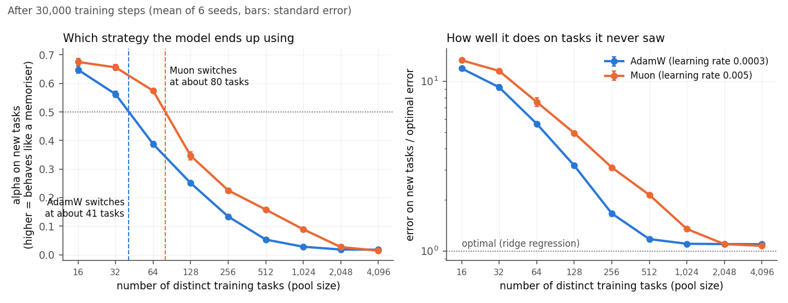
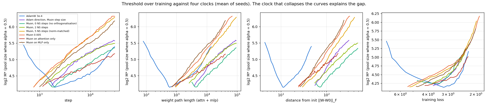

# How does the optimizer shape in-context learning? Muon vs AdamW

A CS182 project. We train small transformers on in-context linear regression with Muon or
AdamW and measure how the optimizer changes three things: whether in-context learning (ICL)
appears, when it appears and fades, and how many in-context examples the model needs. The
main lever is task diversity, the number M of distinct regression tasks seen in training.
Below a threshold the model memorises the task pool; above it, it learns to do regression
from the prompt (Raventós et al. 2023). We ask whether Muon moves that threshold, and why.
A follow-up (Runs 6 to 8) isolates the cause and adds a second task, in-context
letter-substitution ciphers.

## What we found



- With a new task in every prompt, the two optimizers end up equally good.
- With a limited pool of tasks, Muon memorises the pool sooner. After 30,000 steps it needs 77
  to 80 distinct tasks before in-context learning wins, against 23 to 49 for AdamW depending on
  its learning rate (6 of 6 seeds in every pairing of learning rates that train stably).
- On a step axis, AdamW reaches each threshold about 4 times later than Muon, and in-context
  learning eventually fades for both. The follow-up shows this is not only a matter of speed:
  no measure of training progress (distance travelled, distance from initialisation, training
  loss) brings the two optimizers onto one curve.
- Both parts of Muon's update, the equal step sizes and the orthogonalisation, contribute.
- With 2,048 or more tasks the two are indistinguishable after 30,000 steps.
- Muon's highest learning rate, 0.02, does not train stably on the smallest pools. By the rule
  we fixed in advance it still counts, and the gap fails there. `WRITEUP.md` section 5 gives
  both readings.

### Why Muon memorises more (follow-up, Runs 6 and 7)



| Setting (changes only how the block matrices are updated) | Threshold M* (tasks) |
|---|---|
| AdamW 3e-4 | 41 |
| Adam's update direction at Muon's step size | 48 |
| Muon with orthogonalisation off (0 Newton-Schulz steps), same step size | 41 |
| Muon with 2 Newton-Schulz steps, same step size | 45 |
| Signum at Muon's step size | 51 |
| Muon with 5 Newton-Schulz steps, same step size | 77 |
| Muon 0.005 | 80 |
| Muon on attention matrices only | 36 |
| Muon on MLP matrices only | 71 |

- **Step size is not the cause.** Giving AdamW Muon's step size, or taking away Muon's
  orthogonalisation while keeping its step size, leaves the threshold at AdamW's.
- **Full orthogonalisation is the cause.** Two Newton-Schulz iterations barely move the
  threshold; five reproduce Muon. Signum, which equalises individual entries rather than
  singular directions, recovers about a quarter of the gap.
- **The MLP does the memorising.** Muon on the MLP alone gives most of the effect; Muon on
  attention alone gives none.
- **The gap is a constant factor of about 2 at every width** from 64 to 512 (0.4M to 25M
  parameters). Both thresholds grow with width at the same rate, roughly width^0.44.
- **Counting training compute (FLOPs) rather than steps,** Muon still memorises 2.5x to 6x
  sooner at every width. Its head start in learning in-context regression shrinks with width
  and is gone at width 512, so at that size its compute advantage goes entirely to
  memorisation (`scripts/flops.py`).
- Three seeds per setting in Run 6 and two per width in Run 7; every comparison above has the
  same sign in every seed.

### What each optimizer costs per training step (measured)

One training step is one batch of 256 prompts: a forward and backward pass through the model,
then the optimizer update. The table gives each part in absolute units.

- **Time (ms)** is measured on the GPU. The percentage column divides the optimizer update's
  time by the forward and backward time: 12% means the update adds 12% on top of the model's
  own work for that step.
- **GFLOPs** are billions of arithmetic operations, counted by PyTorch's FLOP counter. It
  counts matrix products only, so the element-wise work of SGD, AdamW and Signum reads 0.0
  and appears in their time instead. Muon's update is matrix products, so its FLOPs are real.
- **Optimizer memory (MB)** is the state each optimizer keeps for the attention and MLP
  matrices. **Peak GPU memory (GB)** is the most memory in use at any point in a step:
  parameters, gradients, optimizer state, activations and temporaries.

| Width | Parameters | Optimizer | Forward + backward (ms) | Optimizer update (ms) | Update as % of forward + backward | Forward + backward (GFLOPs) | Optimizer update (GFLOPs) | Optimizer memory (MB) | Peak GPU memory (GB) |
|---|---|---|---|---|---|---|---|---|---|
| 64 | 0.4M | SGD with momentum | 9.3 | 0.30 | 3% | 21 | 0.0 | 2 | 0.30 |
| 64 | 0.4M | AdamW | 9.2 | 0.66 | 7% | 21 | 0.0 | 3 | 0.31 |
| 64 | 0.4M | Signum | 9.2 | 1.21 | 13% | 21 | 0.0 | 2 | 0.30 |
| 64 | 0.4M | Muon | 9.3 | 3.42 | 37% | 21 | 0.6 | 2 | 0.30 |
| 128 | 1.6M | SGD with momentum | 13.0 | 0.12 | 1% | 81 | 0.0 | 6 | 0.60 |
| 128 | 1.6M | AdamW | 13.1 | 0.19 | 1% | 81 | 0.0 | 13 | 0.60 |
| 128 | 1.6M | Signum | 13.1 | 0.36 | 3% | 81 | 0.0 | 6 | 0.60 |
| 128 | 1.6M | Muon | 13.0 | 3.06 | 24% | 81 | 5.0 | 6 | 0.60 |
| 256 | 6.3M | SGD with momentum | 29.7 | 0.40 | 1% | 317 | 0.0 | 25 | 1.20 |
| 256 | 6.3M | AdamW | 29.7 | 0.66 | 2% | 317 | 0.0 | 50 | 1.23 |
| 256 | 6.3M | Signum | 29.8 | 0.69 | 2% | 317 | 0.0 | 25 | 1.20 |
| 256 | 6.3M | Muon | 29.9 | 2.83 | 9% | 317 | 40.3 | 25 | 1.20 |
| 512 | 25.2M | SGD with momentum | 85.1 | 1.59 | 2% | 1,252 | 0.0 | 101 | 2.50 |
| 512 | 25.2M | AdamW | 85.1 | 2.59 | 3% | 1,252 | 0.0 | 201 | 2.60 |
| 512 | 25.2M | Signum | 84.7 | 1.96 | 2% | 1,252 | 0.0 | 101 | 2.50 |
| 512 | 25.2M | Muon | 85.1 | 10.42 | 12% | 1,252 | 322.1 | 101 | 2.50 |

Muon's update takes about 3 ms per step up to width 256, where launching its many small GPU
operations sets the time, and 10 ms at width 512. AdamW's takes 0.2 to 2.6 ms. Muon keeps half
of AdamW's optimizer memory. Median of three measurements on an RTX A6000; full tables with
ranges in `reports/cost_table.md` (`scripts/measure_cost.py`).

### A second task: in-context ciphers (Run 8)

A hidden permutation of a 16-letter alphabet; the prompt shows 24 (plain, coded) letter pairs
and the model predicts each coded letter. Repeated letters can be copied from the prompt; new
letters can only be guessed among unused codes. Exact Bayes-optimal decoder and memoriser
play the roles of ridge and dMMSE.

- Learning the task requires attention to find the earlier copy of a letter, and training
  first sits on a plateau. **Full Muon escapes it in every run, near step 1,000. AdamW, at
  learning rates 3e-4 to 3e-3, and Muon on the MLP only mostly stay on it.** So Muon's
  orthogonalised updates speed up the in-context circuit in attention, while the same updates
  speed up memorisation in the MLP.
- Where both optimizers fit their pool, Muon again memorises more (256 ciphers: alpha 0.57
  against 0.36).
- With a fresh cipher in every prompt and 30,000 steps, **no AdamW run learned the task at
  learning rates 3e-4, 1e-3 or 3e-3 (0 of 9), while every Muon run did, by step 1,155 (3 of
  3).** Muon on the MLP only learned it in 1 of 3, at step 13,800.
- **Muon on attention only learns the task as fast as full Muon** (6 of 6 runs, on the
  16-letter puzzle and an easier 8-letter one), so Muon's speed-up here lives in attention.
  AdamW fails even the 8-letter puzzle.
- Because AdamW cannot learn the task, the cipher threshold compares full Muon with Muon on
  attention only, which differ only in the MLP. **Muon on the MLP raises the threshold 2.8x**
  (217 against 77 ciphers, 3 of 3 seeds), the same mechanism as in regression.

[`WRITEUP.md`](WRITEUP.md) explains the original experiment and each result in plain language,
with figures and caveats. [`WRITEUP_MECHANISM.md`](WRITEUP_MECHANISM.md) does the same for
Runs 6 to 8.

## Documents

- [`WRITEUP.md`](WRITEUP.md): what we did and what we found (Runs 1 to 5)
- [`WRITEUP_MECHANISM.md`](WRITEUP_MECHANISM.md): why Muon memorises more, width scan, and the cipher task (Runs 6 to 8)
- [`LOG.md`](LOG.md): results, run by run
- [`PLAN.md`](PLAN.md): the design, measurements, primary endpoints, significance test and fallbacks, fixed before the runs
- [`reports/`](reports): the generated tables and figures behind every number

## Code

| File | What |
|---|---|
| `icl/data.py` | task pool, prompt sampler, ridge and dMMSE reference predictors |
| `icl/model.py` | GPT-2-style transformer over interleaved (x, y) tokens (Garg et al. 2022 format) |
| `icl/optim.py` | Muon (Keller Jordan's update), routing: block matrices get the optimizer under study, all else AdamW |
| `icl/metrics.py` | everything measured at each evaluation: errors by context length, distance to ridge/dMMSE, memorisation score, attention, weight spectra |
| `train.py` | one training run, writing `metrics.jsonl`, checkpoints, `done.json` |
| `sweep.py` | many runs sharing one GPU |
| `analyze.py`, `stats.py` | per-run table and figures; paired statistics across seeds |
| `scripts/compare_opts.py` | all optimizers in one threshold table (Run 4) |
| `scripts/threshold_over_time.py`, `scripts/run03_dynamics.py` | the threshold during training, the clock test and the fade table (Runs 2 and 3) |
| `scripts/examples_needed.py` | how many in-context examples each model needs (question 3) |
| `scripts/run05_robustness.py`, `scripts/run05_table.py` | learning-rate and weight-decay robustness, by the rules fixed in `PLAN.md` (Run 5) |
| `scripts/writeup_figs.py`, `scripts/writeup_numbers.py`, `scripts/check_writeup.py` | the figures and derived numbers in `WRITEUP.md`, and a check that its numbers match the reports |
| `icl/cipher.py`, `icl/cipher_model.py` | cipher task: pool, sampler, exact in-context decoder and pool memoriser; token-in, softmax-out version of the model |
| `train_cipher.py`, `sweep_cipher.py` | one cipher training run; many cipher runs sharing one GPU |
| `scripts/run06_mech.py` | Run 6: threshold per optimizer variant, and the threshold against four clocks |
| `scripts/measure_cost.py`, `scripts/cost_report.py` | measured FLOPs, time per step and optimizer memory for every optimizer and width, and their tables and figure |
| `scripts/flops.py` | training FLOPs per step, and the threshold against cumulative compute across widths |
| `scripts/run07_capacity.py` | Run 7: threshold against width, and Signum at Muon's step size |
| `scripts/run08_cipher.py` | Run 8: cipher threshold, errors and training curves |
| `tasks/` | the exact arguments of every run, one per line |
| `jobs/` | SGE job scripts (cluster-specific interpreter paths go in an uncommitted `jobs/site.env`) |

Quick start (CPU, about a minute):

```bash
python train.py --opt muon --lr 0.02 --M 16 --steps 300 --n_layer 2 --n_embd 64 --device cpu --out results/demo
python analyze.py results/demo --figs reports/figs/demo
```

Follow-up options in `train.py`: `--ns_steps` (Newton-Schulz iterations), `--fro_match` (rescale
every Muon or Signum update to full Muon's Frobenius norm), `--route attn|mlp` (which block
matrices get the optimizer under study), `--opt adamw_fn` (Adam's direction at Muon's step size)
and `--eval_pct`. The cipher task:

```bash
python train_cipher.py --opt muon --lr 0.005 --aux_lr 3e-4 --M 256 --steps 15000 --out results/cipher_demo
```

Runs 6 to 8 were trained on RTX A6000 GPUs, five or six runs sharing a GPU, in 32-bit floats.

The per-run metrics are several hundred megabytes and are not in the repository. The tables
and figures under `reports/` were generated from them.

## References

Garg et al. 2022 (arXiv:2208.01066); Raventós et al. 2023 (arXiv:2306.15063); Singh et al.
2023 (arXiv:2311.08360); Carroll et al. 2025 (arXiv:2501.17745); Kirsch et al. 2022
(arXiv:2212.04458); Nguyen and Reddy 2024 (arXiv:2412.00104); Jordan et al. 2024, Muon
(kellerjordan.github.io/posts/muon); Liu et al. 2025 (arXiv:2502.16982); Wang et al. 2025, Muon
in tail-end associative memory (arXiv:2509.26030); Muon in associative memory learning, 2026
(arXiv:2602.05725); The Active Ingredient in Muon's Grokking, 2026 (arXiv:2607.20512).
