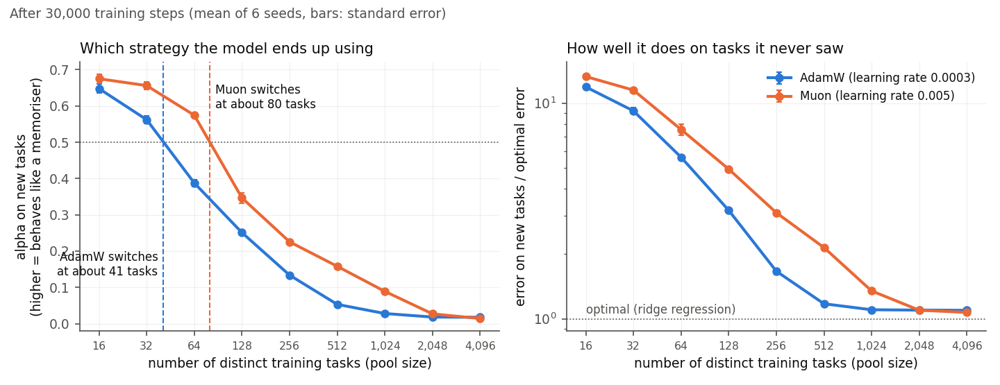

# How does the optimizer shape in-context learning? Muon vs AdamW

A CS182 project. We train small transformers on in-context linear regression with Muon or
AdamW and measure how the optimizer changes three things: whether in-context learning (ICL)
appears, when it appears and fades, and how many in-context examples the model needs. The
main lever is task diversity, the number M of distinct regression tasks seen in training.
Below a threshold the model memorises the task pool; above it, it learns to do regression
from the prompt (Raventós et al. 2023). We ask whether Muon moves that threshold, and why.

## What we found



- With a new task in every prompt, the two optimizers end up equally good.
- With a limited pool of tasks, Muon memorises the pool sooner. After 30,000 steps it needs 77
  to 80 distinct tasks before in-context learning wins, against 23 to 49 for AdamW depending on
  its learning rate (6 of 6 seeds in every pairing of learning rates that train stably).
- The difference is one of speed: AdamW reaches each threshold about 4 times later than Muon,
  and in-context learning eventually fades for both.
- Both parts of Muon's update, the equal step sizes and the orthogonalisation, contribute.
- With 2,048 or more tasks the two are indistinguishable after 30,000 steps.
- Muon's highest learning rate, 0.02, does not train stably on the smallest pools. By the rule
  we fixed in advance it still counts, and the gap fails there. `WRITEUP.md` section 5 gives
  both readings.

[`WRITEUP.md`](WRITEUP.md) explains the experiment and each result in plain language, with
figures and caveats.

## Documents

- [`WRITEUP.md`](WRITEUP.md): what we did and what we found
- [`LOG.md`](LOG.md): results, run by run
- [`PLAN.md`](PLAN.md): the design, measurements, primary endpoints, significance test and fallbacks, fixed before the runs
- [`reports/`](reports): the generated tables and figures behind every number

## Code

| File | What |
|---|---|
| `icl/data.py` | task pool, prompt sampler, ridge and dMMSE reference predictors |
| `icl/model.py` | GPT-2-style transformer over interleaved (x, y) tokens (Garg et al. 2022 format) |
| `icl/optim.py` | Muon (Keller Jordan's update), routing: block matrices get the optimizer under study, all else AdamW |
| `icl/metrics.py` | everything measured at each evaluation: errors by context length, distance to ridge/dMMSE, memorisation score, attention, weight spectra |
| `train.py` | one training run, writing `metrics.jsonl`, checkpoints, `done.json` |
| `sweep.py` | many runs sharing one GPU |
| `analyze.py`, `stats.py` | per-run table and figures; paired statistics across seeds |
| `scripts/compare_opts.py` | all optimizers in one threshold table (Run 4) |
| `scripts/threshold_over_time.py`, `scripts/run03_dynamics.py` | the threshold during training, the clock test and the fade table (Runs 2 and 3) |
| `scripts/examples_needed.py` | how many in-context examples each model needs (question 3) |
| `scripts/run05_robustness.py`, `scripts/run05_table.py` | learning-rate and weight-decay robustness, by the rules fixed in `PLAN.md` (Run 5) |
| `scripts/writeup_figs.py`, `scripts/writeup_numbers.py`, `scripts/check_writeup.py` | the figures and derived numbers in `WRITEUP.md`, and a check that its numbers match the reports |
| `tasks/` | the exact arguments of every run, one per line |
| `jobs/` | SGE job scripts (cluster-specific interpreter paths go in an uncommitted `jobs/site.env`) |

Quick start (CPU, about a minute):

```bash
python train.py --opt muon --lr 0.02 --M 16 --steps 300 --n_layer 2 --n_embd 64 --device cpu --out results/demo
python analyze.py results/demo --figs reports/figs/demo
```

The per-run metrics are several hundred megabytes and are not in the repository. The tables
and figures under `reports/` were generated from them.

## References

Garg et al. 2022 (arXiv:2208.01066); Raventós et al. 2023 (arXiv:2306.15063); Singh et al.
2023 (arXiv:2311.08360); Carroll et al. 2025 (arXiv:2501.17745); Kirsch et al. 2022
(arXiv:2212.04458); Nguyen and Reddy 2024 (arXiv:2412.00104); Jordan et al. 2024, Muon
(kellerjordan.github.io/posts/muon); Liu et al. 2025 (arXiv:2502.16982).
