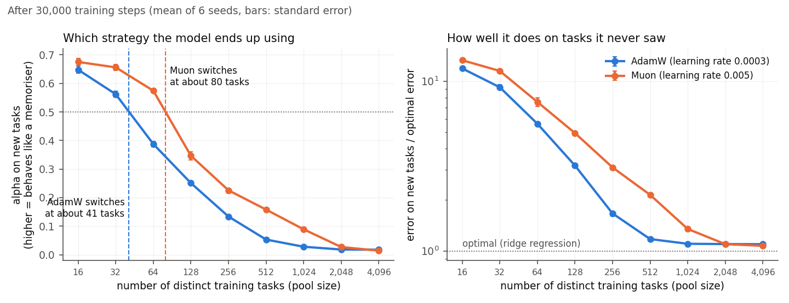
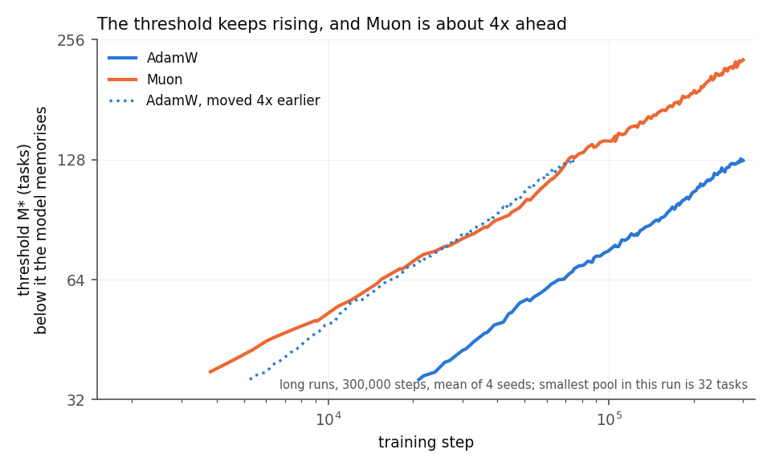
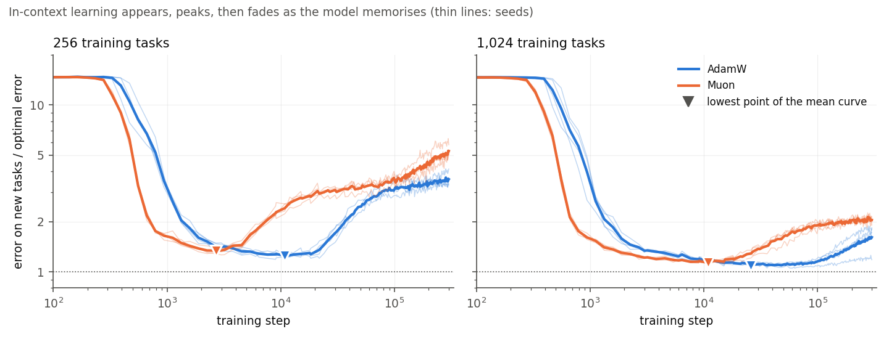
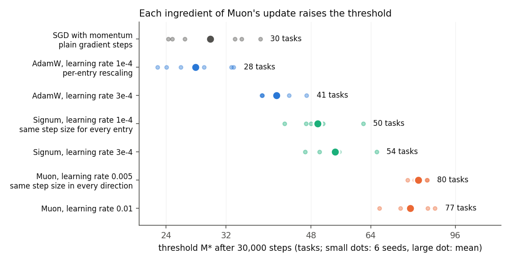
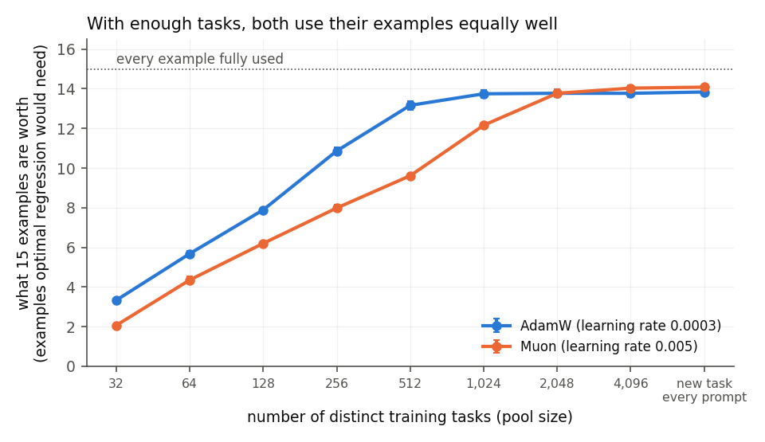
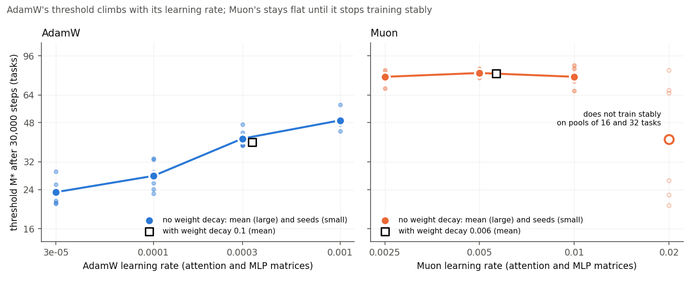

# What we found: Muon, AdamW and in-context learning

This is the plain-language account of the project. The run-by-run record is in
[LOG.md](LOG.md), the design that was fixed before the runs is in [PLAN.md](PLAN.md), and every
table quoted here is produced by a script in this repository (see
[Where each number comes from](#where-each-number-comes-from)).

## The short version

We trained small transformers to do linear regression from the examples in their prompt, and
changed one thing between runs: the optimizer used on the attention and MLP weight matrices.
Across 778 finished training runs, AdamW and Muon differ in one specific way.

- When every prompt is a new task, both optimizers end up equally good, between 1.06x and
  1.10x the best possible error.
- When training draws from a limited pool of tasks, Muon memorises the pool sooner. After
  30,000 steps a Muon-trained model needs about 77 to 80 distinct tasks before it does real
  regression on new tasks. AdamW needs 23 to 49, depending on its learning rate. Muon's
  threshold is the higher one in 6 of 6 seeds for every pairing of learning rates that train
  stably.
- The difference is one of speed. Both thresholds keep rising for as long as we trained
  (300,000 steps), and AdamW reaches each threshold about 4 times later than Muon.
- In-context learning is temporary in this setting, for both optimizers and at every pool size
  up to 1,024 tasks. It appears, peaks, and is then replaced by memorisation. Muon peaks 2.9
  to 4.5 times sooner.
- Both things Muon does to an update contribute. Giving every weight the same step size
  (Signum) accounts for part of the gap, and orthogonalising the update adds the rest.
- With 2,048 or more tasks the two optimizers are indistinguishable after 30,000 steps,
  including in how well they use the examples in the prompt.
- One setting needs care. Muon at its highest learning rate, 0.02, does not train stably on the
  smallest pools. Counted the way our pre-set rule requires, it breaks the pattern. Section 5
  gives both readings.

## The experiment

### The task

A prompt is 16 pairs (x, y). Each x is a random vector with 8 entries, and y = w·x plus noise,
where w is a hidden weight vector that stays the same throughout the prompt. The model reads the
pairs in order and predicts each y from the pairs before it. No weights change while it reads,
so whatever it learns about w it has to learn from the prompt. That is in-context learning.

### Two ways to do well in training

The hidden w is drawn from a fixed pool of M weight vectors chosen before training. A model can
do well on that pool in two ways. It can memorise the M vectors and use the prompt only to work
out which one it is looking at. Or it can learn to do regression from the prompt, which also
works for a w it has never seen.

Both strategies have an exact best version. Ridge regression is the best possible answer for a
new w. The best possible memoriser is called dMMSE (Raventós et al. 2023). We compare every
model with both, on prompts from the pool and on prompts with new w's. One number, alpha,
places a model between the two on new tasks: the higher it is, the more the model predicts like
the memoriser.

Small pools get memorised and large pools force regression. The pool size at which a model sits
halfway between the two (alpha = 0.5) is the task-diversity threshold, M*. The project asks
whether the optimizer moves it.

### The model and the optimizers

The model is a GPT-2-style transformer with 8 layers, width 128 and 2 heads, about 1.6 million
parameters, trained from scratch.

AdamW scales each weight's step by the recent size of that weight's gradient. Muon (Jordan et
al. 2024) takes the whole update for a weight matrix and orthogonalises it, so every direction
of the matrix moves by the same amount. Only the attention and MLP matrices switch optimizer.
Everything else (the input and output layers, the positional embedding, layer norms and biases)
is trained with AdamW at one fixed learning rate in every run.

### How runs are compared

A seed fixes the task pool, the starting weights and the training batches. Runs with the same
seed therefore differ only in the optimizer setting, and every comparison is made seed against
seed. Most comparisons use 6 seeds. The test is a paired sign-flip permutation test, for which
6 seeds give a smallest possible p-value of 0.031, so we also report how many seeds agree. The
measurements, the definition of the threshold and the test were written down in PLAN.md before
the main runs.

## Results

### 1. Muon needs more distinct tasks before in-context learning wins



After 30,000 steps, a model trained with AdamW at learning rate 3e-4 switches from memorising to
regressing at about 41 tasks. With Muon at 0.005 the switch comes at about 80. Between 16 and
1,024 tasks the Muon model has the lower error on its pool and the higher error on new tasks in
every seed. With 128 tasks, for example, AdamW at 1e-4 ends at 1.93x the optimal error on new
tasks and Muon at 4.94x.

The threshold at each learning rate we tried:

| Optimizer | Learning rate | Threshold M* (tasks) |
|---|---|---|
| AdamW | 3e-5 | 23 |
| AdamW | 1e-4 | 28 |
| AdamW | 3e-4 | 41 |
| AdamW | 1e-3 | 49 |
| Muon | 0.0025 | 77 |
| Muon | 0.005 | 80 |
| Muon | 0.01 | 77 |

Muon's threshold is above AdamW's in all 12 pairings of these learning rates, by 0.65 to 1.78
doublings (1.57x to 3.44x more tasks), in 6 of 6 seeds each time (p = 0.031). Muon at 0.02 is
left out of the table because it does not train stably on small pools. Section 5 covers it.

With 2,048 or more tasks, or a new task in every prompt, the two optimizers end within 3% of
each other.

Muon also starts in-context learning sooner: 1.3x to 2.8x sooner at every pool size from 32 up,
in each of the four pairings of the main sweep.

### 2. The gap is a head start in time



The threshold moves during training. Early on every model regresses from the prompt. Then
memorisation takes over, small pools first, so the threshold climbs. In runs ten times longer
(300,000 steps, 4 seeds, AdamW at 3e-4 against Muon at 0.005) it climbs at the same pace for
both optimizers, about 1.5 doublings for every tenfold increase in steps, and neither levels
off.

Muon stays ahead by a roughly constant factor. For each of AdamW's steps we found the step at
which Muon had already reached the same threshold:

| AdamW at step | AdamW's threshold (tasks) | Muon was there by step | AdamW needed this many times more steps |
|---|---|---|---|
| 30,000 | 43 | 5,253 | 5.7 |
| 60,000 | 61 | 14,303 | 4.3 |
| 150,000 | 90 | 42,460 | 3.8 |
| 300,000 | 127 | 79,896 | 4.2 |

From about 45,000 steps on, the factor stays near 4 (individual seeds range from 2.4 to 6.2).
At the end of these runs Muon's threshold is 228 tasks against AdamW's 127, with Muon higher in
4 of 4 seeds. So "Muon needs more tasks" is a statement about a matched number of training
steps. Give AdamW about four times as many steps and it memorises as much.



The same long runs show that in-context learning does not last here. At every pool size from 32
to 1,024 tasks, both optimizers first learn to regress from the prompt, reach their best error
on new tasks, and then lose it as memorisation takes over. With 1,024 tasks, AdamW gets to 1.08x
the optimal error around step 35,727 and ends at 1.62x. Muon reaches its best error 2.9 to 4.5
times sooner than AdamW and is 10% above its best 3.8 to 5.2 times sooner, in 4 of 4 seeds at
every pool size.

### 3. Both parts of Muon's update contribute



Muon does two things to an update. It makes the step the same size everywhere, and it
orthogonalises it. Two other optimizers separate these. Signum takes the sign of the momentum,
so every weight gets a step of the same size and nothing is orthogonalised. SGD with momentum
does neither.

SGD lands on AdamW: 30 tasks against 28 for AdamW at 1e-4, a difference of 0.10 doublings
(p = 0.156). Signum lands between AdamW and Muon at both learning rates we tried, at 50 and 54
tasks. At a matched learning rate of 3e-4, Signum is 0.41 doublings above AdamW. Muon is a
further 0.52 to 0.70 doublings above Signum in all four pairings. Each of the Signum and Muon
differences has the same sign in 6 of 6 seeds.

One measurement follows the same order: the number of directions over which each optimizer's
weight changes are spread (the effective rank of the change since initialisation). Where the
models memorise, it increases from AdamW to Signum to Muon. SGD breaks the pattern, with the
lowest spread of all and the same memorisation as AdamW, so the spread of the update cannot be
the whole explanation.

### 4. With enough tasks, both use their examples equally well



The third question was how many in-context examples each model needs. We measure it as what 15
examples are worth: the number of examples optimal regression would need to match the model's
error after 15. A model that gets everything out of its prompt scores 15.

With 2,048 or more tasks both optimizers score about 14 (13.8 each at 2,048 tasks). Below that,
Muon's models get less from each example, in all four learning-rate pairings of the main sweep
and in 6 of 6 seeds. At 256 tasks a Muon model's 15 examples are worth 8.0, against 10.9 for
AdamW at 3e-4 and 12.5 at 1e-4. So the optimizer leaves a model that has learned regression
just as good at using its prompt, and a model that has memorised more gets less out of it.

### 5. Learning rate and weight decay



The comparison above depends on which learning rates are compared. A last set of 288 runs moved
each optimizer one learning-rate step in both directions and added weight decay. The rules for
reading these runs were written into PLAN.md before any of them finished.

AdamW's threshold rises with its learning rate at every step, from 23 tasks at 3e-5 to 49 at
1e-3, in 6 of 6 seeds each time. One step further, at 3e-3, AdamW no longer learns the task. So
at the highest learning rate it tolerates, AdamW still switches at 49 tasks, against 77 for
Muon's lowest stable setting: a gap of 0.65 doublings in 6 of 6 seeds (p = 0.031). Muon's
threshold does not move with its learning rate between 0.0025 and 0.01.

Muon at 0.02 is the exception, and it decides how the result has to be stated. With 16 and 32
tasks it memorises the pool early and then loses it: 4 of 6 runs at 16 tasks and 6 of 6 at 32
end with an error on their own training tasks more than 1.3x what ridge regression gets there.
No run at any other setting does that. A model in that state is neither memorising nor
regressing, so alpha says nothing about which it prefers. In three of the six seeds these runs
pull alpha below 0.5 at 32 tasks, and the threshold calculation reads that as a switch to
in-context learning at fewer than 32 tasks.

The filter we fixed in advance tests each setting on an infinite pool only, and Muon at 0.02
passes it. So by the rule exactly as written, Muon's lowest threshold is the 40 tasks measured
at 0.02, which is above AdamW's 49 in only 3 of 6 seeds, and the gap does not survive tuning.
Applying the same 1.3x test at every pool size removes Muon at 0.02 and no other setting, and
the gap then survives in 6 of 6 seeds, as described above. That second test was added after
seeing these runs, and the report labels it that way. Where Muon at 0.02 does train, it is
still on the memorising side of AdamW at 1e-3, in 6 of 6 seeds at 64, 128 and 256 tasks.

One of the 48 runs at Muon 0.02 (1,024 tasks, seed 1) hit the cluster's time limit at step
29,700 of 30,000 and is left out. It is far from the threshold.

Weight decay leaves the result as it was. With both optimizers' matrices shrunk by the same
factor per step, Muon's threshold is 80 tasks and AdamW's 39, a gap of 1.03 doublings in 6 of 6
seeds. Decay moved neither threshold by more than 0.05 doublings. It reduced fading a little: at
128 tasks the final error over the best error went from 2.11 to 1.94 for AdamW and from 2.86 to
2.75 for Muon.

One more result came out of these runs. AdamW at 1e-3 and Muon at 0.0025 start in-context
learning at the same step (the ratio of their onset steps is 0.99, with a 95% interval of 0.92
to 1.06), and Muon's threshold is still 0.65 doublings higher. So how soon regression appears
does not determine how soon memorisation follows. Raising Muon's learning rate from 0.0025 to
0.01 brings the first forward, from about step 586 to between 340 and 390, and leaves the
second where it was.

## What this does not show

- There is one model size, one task family (linear regression in 8 dimensions with 16
  examples), one batch size (256) and a constant learning rate after warm-up.
- All runs trained on CPU nodes in 32-bit floats. Every run inside one comparison used the same
  hardware.
- Every threshold is tied to a number of training steps, because it keeps rising with training.
- The long runs have 4 seeds and one learning-rate pair. Four seeds make 0.125 the smallest
  possible p-value, so for those runs the seed counts are the evidence.
- alpha = 0.5 is a convention. The alpha curves of the two optimizers are separated at every
  level, as the first figure shows.
- Two measures were added after seeing results, and are labelled that way in the reports.
  "What 15 examples are worth" replaced a planned measure (the first prompt length within 10%
  of ridge) that turned out to flip between 0 and 13 from seed to seed. The check that a run
  fits its own pool was added for Muon at 0.02.
- We have measured what differs and when. Why Muon's memorisation speed does not follow its
  learning rate is still open.

## Reproducing

```bash
python train.py --opt muon --lr 0.005 --M 64 --seed 0 --pool_seed 0 --steps 30000 --aux_lr 3e-4 --out results/demo
python analyze.py results/demo --figs reports/figs/demo
```

A 30,000-step run took a median of 76 minutes on 8 CPU cores. The files in `tasks/` list the exact
arguments of every run, one per line, and `jobs/cpu_array.sh` runs one line per array task on an
SGE cluster. The per-run metrics are several hundred megabytes and are not in the repository.
Everything under `reports/` was generated from them by the scripts below.

## Where each number comes from

| Section | Report | Command |
|---|---|---|
| Short version, 1 | `reports/run05_robustness.md`, `reports/run04_compare.md`, `reports/figs/run02/*/stats.md`, `reports/writeup_numbers.md` | `python stats.py results/run02_main --figs reports/figs/run02/a3e-4_m0.005 --lr_a 3e-4 --lr_b 0.005` (one per pairing) |
| 2 | `reports/run03_dynamics.md`, `reports/writeup_numbers.md` | `python scripts/run03_dynamics.py results/run03_long reports/figs/run03` |
| 3 | `reports/run04_compare.md`, `reports/figs/run04/*/stats.md` | `python scripts/compare_opts.py results/run02_main --figs reports/figs/run04 --runs adamw:1e-4 adamw:3e-4 sgdm:0.1 signum:1e-4 signum:3e-4 muon:0.005 muon:0.01` |
| 4 | `reports/q3_examples_needed_run02.md` | `python scripts/examples_needed.py final results/run02_main reports/figs/run02` |
| 5 | `reports/run05_robustness.md` | `python scripts/run05_robustness.py results/run02_main results/run05b_wd reports/run05_robustness.md reports/figs/run05` |
| Derived figures (factors, run counts) | `reports/writeup_numbers.md` | `python scripts/writeup_numbers.py results > reports/writeup_numbers.md` |
| Figures | `reports/figs/writeup/` | `python scripts/writeup_figs.py results/run02_main results/run03_long reports/figs/writeup` |

`python scripts/check_writeup.py` checks that every number in this file appears in one of those
reports.

## References

- Garg, Tsipras, Liang, Valiant. What Can Transformers Learn In-Context? A Case Study of Simple Function Classes. 2022. arXiv:2208.01066
- Raventós, Paul, Chen, Ganguli. Pretraining Task Diversity and the Emergence of Non-Bayesian In-Context Learning for Regression. 2023. arXiv:2306.15063
- Singh, Chan, Moskovitz, Grant, Saxe, Hill. The Transient Nature of Emergent In-Context Learning in Transformers. 2023. arXiv:2311.08360
- Carroll, Hoogland, Farrugia-Roberts, Murfet. Dynamics of Transient Structure in In-Context Linear Regression Transformers. 2025. arXiv:2501.17745
- Nguyen, Reddy. Differential Learning Kinetics Govern the Transition from Memorization to Generalization during In-Context Learning. 2024. arXiv:2412.00104
- Jordan et al. Muon: An Optimizer for Hidden Layers in Neural Networks. 2024. kellerjordan.github.io/posts/muon
- Liu et al. Muon is Scalable for LLM Training. 2025. arXiv:2502.16982
- Wang et al. Muon Outperforms Adam in Tail-End Associative Memory Learning. 2025. arXiv:2509.26030
- Dragutinović, Zhang, Ranganath. To Use or not to Use Muon: How Simplicity Bias in Optimizers Matters. 2026. arXiv:2603.00742
