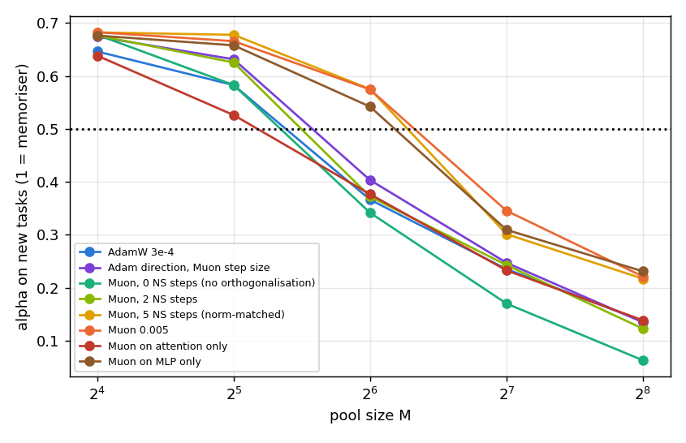
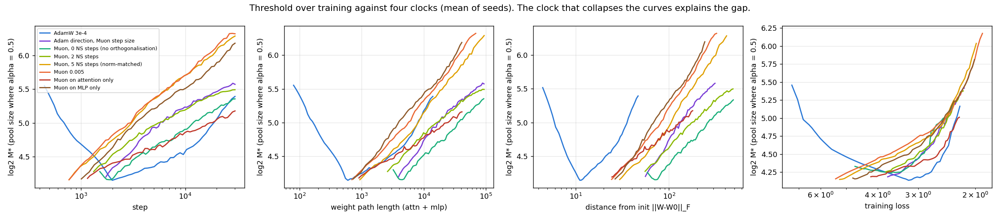
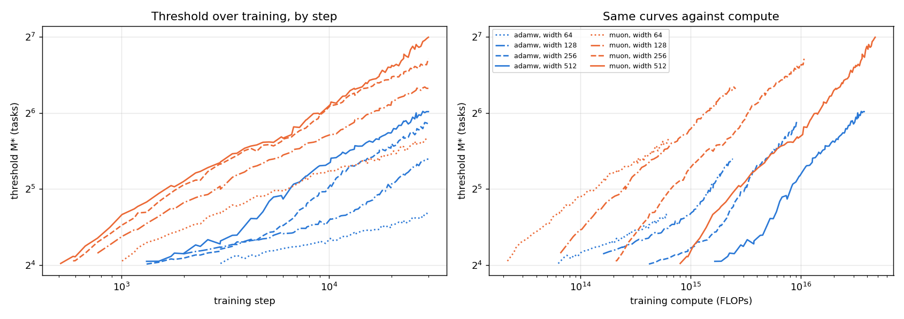
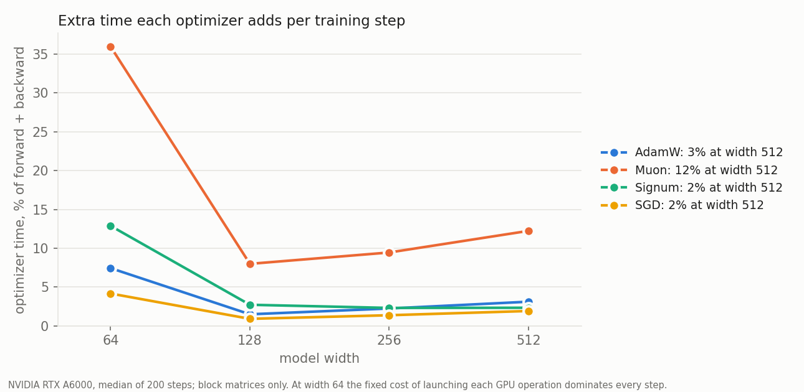
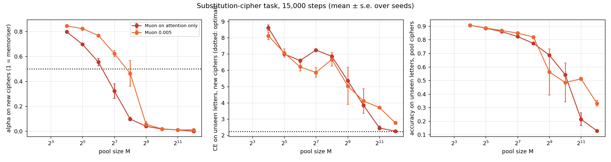

# Why does Muon memorise more? Mechanism, capacity and a second task

This document continues [WRITEUP.md](WRITEUP.md). That write-up established *what* differs
between Muon and AdamW on in-context linear regression: at a matched number of steps Muon
needs about twice the task diversity (M* of 80 against 41) before in-context learning wins,
and it left open *why*. Runs 6 to 8 answer that. Every number here is produced by a script
under `scripts/` from saved metrics; see [Where each number comes from](#where-each-number-comes-from).

## The short version

- **It is not a clock effect.** Giving AdamW's update Muon's step length moves the
  threshold by a quarter of the gap. Re-plotting the threshold against distance travelled in
  weight space, distance from initialisation, or training loss never brings the optimizers
  together. Muon changes what is learned, not only how fast.
- **The cause is orthogonalisation, applied fully.** Muon with its orthogonalisation
  switched off (same momentum, same step length) sits exactly on AdamW. Two Newton-Schulz
  iterations, which only partly flatten the update spectrum, barely move the threshold.
  Five iterations reproduce Muon.
- **The memorising happens in the MLP.** Muon applied to the MLP matrices alone gives
  about 80% of the gap. Muon applied to the attention matrices alone gives none of it.
  The effective rank of the MLP weight change separates every memorising setting from
  every non-memorising one, whatever the attention matrices do.
- **The gap is a constant factor of about 2 at every model width** from 64 to 512 (0.4M to
  25M parameters). Both thresholds grow with width at the same rate, so Muon does not scale
  differently, it uses a fixed larger share of the same capacity.
- **Signum sits between AdamW and Muon even at matched step length**, which reconciles the
  original Signum result: equalising entries recovers a quarter of the gap, equalising singular
  directions recovers all of it.
- **Counting training compute (FLOPs) instead of steps,** Muon still memorises 2.5x to 6x
  sooner at every width, but its head start in learning the in-context algorithm shrinks with
  size and is gone at width 512.
- **Measured on the GPU, Muon's step costs 8% to 12% more time than the model's forward and
  backward pass** at widths 128 to 512 (AdamW: 2% to 3%), and needs half of AdamW's optimizer
  memory.
- **On a second task, letter-substitution ciphers,** Muon again memorises larger pools, and it
  also finds the in-context copy circuit far faster than AdamW, which often stays stuck on a
  plateau. With an unlimited pool and 30,000 steps, no AdamW run at any of three learning rates
  learned the task, while every Muon run did within about 1,000 steps. A stuck model neither
  memorises nor decodes. Muon on attention only learns the task as fast as full Muon (Run 8c),
  which places this effect in attention, and AdamW fails even an easier 8-letter version.
  Comparing full Muon with Muon on attention only, which differ only in the MLP, Muon on the
  MLP raises the cipher threshold 2.8x (217 against 77 ciphers, 3 of 3 seeds): the regression
  mechanism holds on a second task.

## Run 6: which ingredient of Muon's update, and in which block

### Design

Pool sizes 16, 32, 64, 128 and 256, three paired seeds, 30,000 steps, the model of the main
runs (8 layers, width 128). Eight settings, each a single change to the update of the block
weight matrices; everything else is AdamW at 3e-4 as before.

| Setting | What it changes |
|---|---|
| AdamW 3e-4 | the baseline |
| Adam direction, Muon step size | Adam's update, rescaled per matrix to the Frobenius norm a Muon update has |
| Muon, 0 Newton-Schulz steps | Muon's momentum, normalised to Muon's step length, no orthogonalisation |
| Muon, 2 Newton-Schulz steps | partial orthogonalisation at the same step length |
| Muon, 5 Newton-Schulz steps, norm-matched | full orthogonalisation at exactly the same step length (a control for the knob) |
| Muon 0.005 | the baseline |
| Muon on attention only | Q, K, V, O get Muon; the MLP matrices get AdamW 3e-4 |
| Muon on MLP only | the reverse |

New measurements: the cumulative Frobenius length of the path each block's weights travel,
and the Frobenius norm of each matrix's change since initialisation (alongside the effective
rank already measured).

### Result

| Setting | M* (tasks) | log2 M* per seed | vs AdamW (doublings, per seed) |
|---|---|---|---|
| AdamW 3e-4 | 41 | 5.43 5.21 5.49 | 0 |
| Adam direction, Muon step size | 48 | 5.51 5.54 5.69 | +0.21 (+0.08 +0.33 +0.20) |
| Muon, 0 NS steps | 41 | 5.39 5.29 5.34 | -0.03 (-0.04 +0.08 -0.14) |
| Muon, 2 NS steps | 45 | 5.50 5.40 5.58 | +0.12 (+0.07 +0.19 +0.09) |
| Muon, 5 NS steps, norm-matched | 77 | 6.23 6.15 6.42 | +0.89 (+0.80 +0.95 +0.93) |
| Muon 0.005 | 80 | 6.35 6.31 6.31 | +0.95 (+0.92 +1.10 +0.83) |
| Muon on attention only | 36 | 5.27 4.90 5.29 | -0.22 (-0.16 -0.31 -0.19) |
| Muon on MLP only | 71 | 6.16 5.92 6.39 | +0.78 (+0.73 +0.72 +0.90) |

The settings fall into two groups with nothing in between: {AdamW, Adam direction at Muon's
step, 0 and 2 Newton-Schulz steps, Muon on attention only} at 36 to 48 tasks, and {Muon, 5
Newton-Schulz steps norm-matched, Muon on MLP only} at 71 to 80 tasks. Every difference
between the groups has the same sign in 3 of 3 seeds.

**Step size is not the cause.** The Adam-direction control walks 7 times further in weight
space than AdamW (path length 53,000 against 7,400 for the attention matrices at 64 tasks)
and ends 5 times further from initialisation, yet its threshold is within a quarter of a
doubling of AdamW's. The 0-step Muon variant has the same step length as Muon and the same
threshold as AdamW.

**Orthogonalisation is the cause, and it has to be complete.** With the step length held
fixed, 0 and 2 Newton-Schulz iterations leave the threshold at AdamW's, and 5 iterations
reproduce Muon's. Two iterations of the quintic Newton-Schulz polynomial leave the small
singular values of the update small; five bring every singular value near 1. So it is the
flat spectrum itself, not partial whitening, that memorises.

**The MLP does the memorising.** Routing Muon to the MLP alone recovers 0.78 of the 0.95
doublings; routing it to attention alone recovers none and lands slightly below AdamW. The
effective rank of the MLP weight change since initialisation, at 64 tasks:

| Setting | eff. rank, attention | eff. rank, MLP | alpha on new tasks |
|---|---|---|---|
| AdamW 3e-4 | 53 | 85 | 0.36 |
| Adam direction, Muon step size | 54 | 80 | 0.36 |
| Muon, 0 NS steps | 32 | 56 | 0.35 |
| Muon, 2 NS steps | 35 | 74 | 0.36 |
| Muon on attention only | 78 | 70 | 0.37 |
| Muon on MLP only | 44 | 115 | 0.54 |
| Muon, 5 NS steps, norm-matched | 76 | 114 | 0.57 |
| Muon 0.005 | 77 | 114 | 0.58 |

A high-rank attention change (attention-only Muon, 78) does nothing; a high-rank MLP change
(114 to 115) is present in exactly the settings that memorise more. (Seed 0; the other seeds
agree.)

**No alternative clock collapses the curves.**

The threshold M*(t) is computed at every evaluation and plotted against the training step,
the cumulative weight-path length, the distance from initialisation and the training loss.
On every axis the settings split into the same two groups. The original write-up's "Muon is
AdamW on a 4x faster clock" describes the step axis well, but there is no quantity along
which the two optimizers follow one curve. The difference is in the solution reached.

### Interpretation

Memorising a pool of tasks means storing many independent associations in the MLP weights.
Adam-style updates concentrate each step in a few dominant singular directions, so stored
associations compete for the same subspace and memorisation saturates early. An
orthogonalised update spreads each step evenly over every direction, so the MLP's full
capacity is available for storing tasks, and the model needs about twice the task diversity
before storing them stops paying off. This is the behaviour predicted for spectral optimizers
by the associative-memory analyses of Wang et al. 2025 and Li et al. 2026, and the ablation
reaches the same "orthogonalisation is the active ingredient" conclusion as the grokking
study of arXiv:2607.20512, with the sign reversed: there the ingredient brings generalisation
sooner, here it brings memorisation sooner.

It also explains the loose end of the main write-up. Muon's threshold did not move with its
learning rate because the learning rate sets how far each step goes, and that does not
matter; the shape of the update spectrum does, and it is fixed.

## Run 7: capacity (width) and the Signum discrepancy

### Design

(a) Model width 64, 256 and 512 for AdamW 3e-4 and Muon 0.005 (width 128 from Run 6), pools 16
to 256, 2 seeds (3 at width 128), 30,000 steps. Depth, heads and everything else unchanged.
The hypothesis: if Muon memorises more because it uses the MLP's storage capacity more fully,
its threshold should grow with width faster than AdamW's. (b) Signum with its update rescaled
to Muon's Frobenius norm, 3 seeds, to separate the sign operation from the step length.

### Result (a): the gap is a constant factor at every width

| Width | Parameters | AdamW M* | Muon M* | Muon minus AdamW (doublings) |
|---|---|---|---|---|
| 64 | 0.40M | 25 | 50 | +0.98 |
| 128 | 1.59M | 41 | 80 | +0.95 |
| 256 | 6.33M | 57 | 100 | +0.81 |
| 512 | 25.2M | 64 | 124 | +0.94 |

Both thresholds grow with width, and at the same rate: M* grows roughly as width^0.45 for
AdamW and width^0.43 for Muon. Muon's threshold is about twice AdamW's at every width, and
higher in every seed at every width.

So the hypothesis of a different scaling exponent is not supported. Width raises how many tasks
both optimizers can memorise; Muon's advantage is a fixed factor of about 2 on top of that,
not a steeper growth. In the bookshelf picture: a bigger bookshelf holds more books for both
students, and Muon always fits about twice as many on a shelf of a given size. With 2 seeds
per width this is a measurement of the trend, not a precise exponent.

### Result (b): Signum sits between, at matched step length

| Setting (all at Muon's Frobenius norm except the baselines) | M* | log2 M* per seed |
|---|---|---|
| AdamW 3e-4 | 41 | 5.43 5.21 5.49 |
| Normalised momentum (Muon, 0 NS steps) | 41 | 5.39 5.29 5.34 |
| Signum, norm-matched | 51 | 5.67 5.55 5.83 |
| Muon 0.005 | 80 | 6.35 6.31 6.31 |

This reconciles WRITEUP.md, which found Signum between AdamW and Muon, with Run 6, which found
normalised momentum on AdamW. At the same step length, rescaling the whole matrix does
nothing, equalising the size of every entry (sign) recovers about a quarter of the gap (0.31
doublings, 3 of 3 seeds above both AdamW and normalised momentum), and equalising every
singular direction (orthogonalisation) recovers all of it.

One caveat: the effective rank of Signum's MLP weight change (79 at 64 tasks, seed 0) is no
higher than AdamW's (85), so the effective-rank measure does not explain Signum's partial
effect. Effective rank tracks the full-Muon settings well; what Signum does is not captured
by it.

## Compute accounting: thresholds against FLOPs

Comparisons so far are at a matched number of steps. Muon does extra work every step (five
Newton-Schulz iterations per weight matrix), so a fair efficiency comparison counts training
compute instead. FLOPs per step are counted analytically: forward and backward passes
(3 x forward, forward = 2 x matrix parameters x tokens plus the attention terms) and, for Muon,
the Newton-Schulz matrix products. `scripts/flops.py` computes them and re-plots the threshold
M*(t) from Runs 6 and 7a against cumulative compute. Curves start after in-context learning has
formed on the largest pool; before that, alpha is near 0.5 at every pool size and the
threshold is noise.

| Width | AdamW GFLOPs per step | Muon GFLOPs per step | Newton-Schulz share of Muon's step |
|---|---|---|---|
| 64 | 21.0 | 21.6 | 2.9% |
| 128 | 80.6 | 85.6 | 5.9% |
| 256 | 316 | 356 | 11.3% |
| 512 | 1,250 | 1,572 | 20.5% |

Muon's overhead grows with width, because Newton-Schulz costs grow with the cube of the matrix
size while the forward and backward passes grow with its square times the number of tokens.

Two ratios, AdamW's compute over Muon's (above 1 means Muon gets there with less compute; 2
seeds per width, 3 at width 128):

| Width | Compute to reach M* = 32 | Compute to reach M* = 48 | Compute to start in-context learning (pool 256) |
|---|---|---|---|
| 64 | AdamW never reaches it | AdamW never reaches it | 1.91x |
| 128 | 6.0x | AdamW never reaches it | 1.24x |
| 256 | 4.5x | 3.0x | 1.16x |
| 512 | 3.0x | 2.5x | 0.98x |

- **Counting compute, Muon still memorises sooner at every width,** by 2.5x to 6x.
- **Its head start in learning the in-context algorithm disappears with scale.** It is about 2x
  at width 64 and gone at width 512, where both optimizers start in-context learning at the
  same compute.
- **So at the largest model, Muon's compute efficiency goes entirely to memorisation.** Per
  FLOP, both optimizers find in-context regression equally fast, and Muon then replaces it with
  memorisation 2 to 3 times sooner.
- Against compute the widths do not fall on one curve: for these pool sizes, a smaller model
  reaches a given threshold with less compute than a larger one, for both optimizers.

Caveats: FLOPs are counted analytically, not measured, and Newton-Schulz runs in bfloat16 in
the reference implementation, which makes its real cost lower than counted here. Two seeds per
width make the onset ratios a trend, not a precise estimate.

## Measured cost of each optimizer

The FLOP counts above are analytic. `scripts/measure_cost.py` measures the real cost on the
training model and data, one setting at a time on an RTX A6000: matrix-product FLOPs from
PyTorch's FLOP counter, the time of each part of a step from CUDA timers (median of 200 steps),
and the optimizer state memory. Full tables are in `reports/cost_table.md`.

Optimizer time as a share of the model's forward and backward pass:

| Optimizer | Width 64 | Width 128 | Width 256 | Width 512 | State memory per weight |
|---|---|---|---|---|---|
| SGD with momentum | 4.2% | 0.9% | 1.4% | 1.9% | 4 bytes |
| AdamW | 7.4% | 1.5% | 2.2% | 3.1% | 8 bytes |
| Signum | 12.9% | 2.7% | 2.3% | 2.3% | 4 bytes |
| Muon, 0 Newton-Schulz steps | 21.0% | 4.6% | 3.7% | 3.7% | 4 bytes |
| Muon, 2 Newton-Schulz steps | 28.9% | 6.2% | 6.2% | 7.4% | 4 bytes |
| Muon (5 Newton-Schulz steps) | 36.0% | 8.0% | 9.5% | 12.2% | 4 bytes |

Muon's measured Newton-Schulz FLOPs match the analytic count exactly (5.03 billion per step at
width 128, 322 billion at width 512), as does the model's forward and backward pass (81.1
against 80.6 billion at width 128).

- **Muon costs 8% to 12% more time per step than the model itself at widths 128 to 512,**
  against 2% to 3% for AdamW. Its share grows with width, as the analytic count predicts.
- **Measured time grows more slowly than counted FLOPs** (12% of time against 26% of FLOPs at
  width 512), because Newton-Schulz runs in bfloat16, which this GPU executes much faster
  than the 32-bit model.
- **Muon needs half of AdamW's optimizer memory** (one momentum buffer instead of two moment
  estimates).
- **At width 64 every optimizer looks expensive** because the model is so small that each step
  is dominated by the fixed cost of launching each GPU operation, and Muon launches the most.
  A second measurement with the CPU idle reproduced these numbers.
- None of this changes the step-matched or FLOP-matched conclusions: Muon's 2x to 6x head start
  in memorisation is far larger than its 8% to 12% cost per step.

## Run 8: a second task, letter-substitution ciphers

### The task

An alphabet of 16 letters and a hidden cipher, a permutation that maps each plain letter to
a coded letter. A prompt is 24 (plain, coded) pairs with plain letters drawn at random; the
model predicts each coded letter from the pairs before it. Two cases arise. If the plain letter
appeared earlier in the prompt, the answer can be copied from the context. If it is new, the
best possible guess is uniform over the coded letters not yet used. A pool of M ciphers is
fixed before training, exactly as the pool of weight vectors is in regression.

Two exact reference predictors play the roles of ridge and dMMSE: the Bayes-optimal in-context
decoder (uniform prior over all permutations) and the Bayes-optimal memoriser (uniform prior
over the pool). Both were checked against brute-force enumeration and agree exactly. alpha is
defined on the predicted probability vectors exactly as before.

The model is the same transformer with a token embedding in place of the linear read-in and a
16-way softmax in place of the scalar read-out. Settings: AdamW 3e-4, Muon 0.005 and Muon on
the MLP only, pools 16 to 4,096 plus unlimited, 2 seeds, 15,000 steps.

### What happened: a training plateau, and Muon escapes it reliably

Learning to decode in context requires an attention circuit that finds the earlier occurrence
of the same plain letter and copies its code, the "induction head" pattern known from language
models. Before that circuit forms, training sits on a plateau with loss near 2.3, the loss of
guessing among unused codes without ever copying.

Full Muon escaped the plateau in every run, at every pool size, between steps 600 and 1,100.
AdamW and Muon-on-MLP, whose attention matrices are both trained by AdamW at 3e-4, often did
not: at pool sizes of 1,024 and above, and with an unlimited pool, 6 of 8 AdamW runs and 5 of 8
Muon-on-MLP runs were still on or near the plateau at step 15,000. Those runs neither memorise nor decode, so their alpha is
meaningless, and the threshold computed from them is not a valid reading. The threshold table in
`reports/run08_table.md` is therefore kept for the record but not interpreted.

Two things can be read from this run already:

- **Where both memorise, Muon memorises more again.** At 256 ciphers, every Muon run fits its
  pool perfectly (accuracy on repeated letters 1.00 on pool ciphers, alpha 0.57 on new ciphers),
  while AdamW is at alpha 0.36 with one of its two seeds failing to fit at all.
- **Muon finds the in-context copy circuit much faster.** On the unlimited pool, full Muon
  started copying by step 1,110 and ended within 0.01 of the optimal decoder's cross-entropy in
  seed 0 (seed 1 started by step 981 and ended 0.16 above optimal), while both AdamW seeds were
  still on the plateau at step 15,000. Muon on
  the MLP only behaved like AdamW, which places this speed-up in the attention matrices, the
  opposite block from the memorisation effect.

That second point is new relative to the regression task, where both optimizers learned
in-context regression easily. On the cipher task Muon's orthogonalised updates help attention
form the copy circuit, while the same updates help the MLP memorise.

### Run 8b: calibration on the unlimited pool

To find settings under which every seed escapes the plateau, Run 8b trained on the unlimited
pool (a fresh cipher in every prompt, so only in-context decoding can lower the loss) for
30,000 steps, twice Run 8's length, with 3 seeds. "Copy onset" is the first step at which
accuracy on repeated letters of new ciphers passes 0.5; "gap to optimal" is the final
cross-entropy on new letters minus the optimal decoder's.

| Setting | Seeds that learned to copy | Copy onset | Accuracy on repeated letters at the end | Gap to optimal at the end |
|---|---|---|---|---|
| AdamW 3e-4 | 0 of 3 | never | 0.19 0.30 0.29 | +0.48 +0.42 +0.43 |
| AdamW 1e-3 | 0 of 3 | never | 0.06 0.42 0.18 | +0.54 +0.41 +0.48 |
| AdamW 3e-3 | 0 of 3 | never | 0.06 0.06 0.06 | +0.54 +0.54 +0.53 |
| Muon on MLP only | 1 of 3 | 13,800 (one seed) | 0.37 0.19 0.68 | +0.39 +0.48 +0.22 |
| Muon 0.005 | 3 of 3 | 1,008 1,008 1,155 | 1.00 0.80 1.00 | +0.00 +0.15 +0.00 |

No AdamW setting learned the task in 30,000 steps. At 3e-3 the loss never left ln 16, the loss
of a uniform guess, so that setting does not train at all. At 3e-4 and 1e-3 the models reached
partial copying (accuracy 0.2 to 0.4, against 1.0 possible) and stayed there. Full Muon learned
the task within about 1,000 steps in every seed, at least 30 times sooner. Muon on the MLP only,
whose attention matrices are trained by AdamW, behaved like AdamW in two seeds and escaped late
in the third.

So on this task the optimizer matters more for learning the in-context algorithm than for
memorising, and the effect comes from how attention is trained. Two caveats: only the block
matrices' learning rate was varied for AdamW, with embeddings and the read-out at 3e-4 in every
run, and a different schedule or warmup might rescue AdamW.

### Run 8c: an easier puzzle, and Muon on attention only

Unlimited pool, 30,000 steps, 3 seeds. An 8-letter alphabet with 16 pairs per prompt, plus Muon
on attention only on the original 16-letter puzzle.

| Puzzle | Setting | Copy onset (per seed) | Accuracy on repeated letters at the end | Gap to optimal at the end |
|---|---|---|---|---|
| 8 letters | AdamW 3e-4 | never | 0.49 0.49 0.48 | +0.39 +0.40 +0.39 |
| 8 letters | AdamW 1e-3 | never, 16,200, 2,400 | 0.48 0.58 0.58 | +0.39 +0.35 +0.39 |
| 8 letters | Muon on MLP only | 2,987 5,887 2,607 | 1.00 1.00 1.00 | +0.00 +0.00 +0.00 |
| 8 letters | Muon 0.005 | 511 511 511 | 1.00 0.99 1.00 | +0.00 +0.03 +0.01 |
| 8 letters | Muon on attention only | 446 390 446 | 1.00 1.00 1.00 | +0.00 +0.00 +0.01 |
| 16 letters | Muon on attention only | 600 671 671 | 0.97 0.99 1.00 | +0.03 +0.01 +0.01 |

- **Muon's speed-up is in attention.** Muon on attention only learns both puzzles as fast as
  full Muon, in 6 of 6 runs, with the MLP trained by AdamW. Muon on the MLP only learns the
  easy puzzle but 5 to 10 times later, and mostly fails the hard one (Run 8b).
- **AdamW does not learn even the easy puzzle.** Two runs at 1e-3 passed the onset criterion
  late, but none got within 0.35 of the optimal decoder's cross-entropy. AdamW's plateau is not
  rescued by a smaller alphabet or a higher learning rate in this budget.

On this task Muon's two effects therefore sit in different blocks: in attention it makes the
in-context algorithm learnable, and in the MLP (Runs 6 and 7) it makes memorisation stronger.

### Run 8d: Muon on the MLP memorises more on the cipher task too

AdamW cannot learn the cipher task, so Run 8d compares two settings that both learn it quickly
and differ only in the MLP: full Muon, and Muon on attention only (MLP on AdamW 3e-4). The
16-letter puzzle, pools 16 to 4,096 plus unlimited, 3 seeds, 15,000 steps. Every run used for
the threshold fit its own ciphers (accuracy on repeated letters of pool ciphers at least 0.9).

| Pool size | alpha, Muon on attention only | alpha, full Muon |
|---|---|---|
| 16 | 0.80 | 0.84 |
| 32 | 0.70 | 0.82 |
| 64 | 0.55 | 0.77 |
| 128 | 0.32 | 0.62 |
| 256 | 0.10 | 0.46 |
| 512 | 0.04 | 0.06 |

| Setting | M* (ciphers) | log2 M* per seed |
|---|---|---|
| Muon on attention only | 77 | 6.47 5.93 6.43 |
| Full Muon | 217 | 7.82 8.27 7.20 |

Switching the MLP from AdamW to Muon raises the threshold by 1.48 doublings (2.8x), in 3 of 3
seeds (+1.35, +2.34, +0.77). This is the Run 6 result on a second, discrete task: orthogonalised
updates to the MLP make the model memorise larger pools before in-context learning wins.

Together with Run 8c, the cipher task separates Muon's two effects cleanly. Muon on attention
makes the in-context algorithm learnable at all; Muon on the MLP makes memorisation stronger.

## Where each number comes from

| Section | Report | Command |
|---|---|---|
| Run 6 | `reports/run06_table.md`, `reports/figs/run06/` | `python scripts/run06_mech.py results/run06_mech reports/figs/run06` |
| Run 7 | `reports/run07_table.md`, `reports/figs/run07/` | `python scripts/run07_capacity.py results/run06_mech results/run07a_width results/run07b_signum reports/figs/run07` |
| Compute accounting | `reports/flops_table.md`, `reports/figs/flops/` | `python scripts/flops.py results/run06_mech results/run07a_width reports/figs/flops` |
| Measured cost | `reports/cost_table.md`, `reports/figs/cost/` | `python scripts/measure_cost.py reports/figs/cost` then `python scripts/cost_report.py reports/figs/cost` |
| Run 8 | `reports/run08_table.md`, `reports/figs/run08/` | `python scripts/run08_cipher.py results/run08_cipher reports/figs/run08` |
| Run 8d | `reports/run08d_table.md`, `reports/figs/run08d/` | `python scripts/run08_cipher.py results/run08d_mlp reports/figs/run08d` |
| Run 8, per-run plateau check | printed table | see the inline check in this section; criterion: accuracy on repeated letters of pool ciphers at least 0.9 |

Run definitions are in `tasks/run06_mech_g*.txt`, `tasks/run07a_width.txt`,
`tasks/run07b_signum_fm.txt` and `tasks/run08_cipher.txt`. New `train.py` flags: `--ns_steps`,
`--fro_match`, `--route {all,attn,mlp}`, `--eval_pct`, and `--opt adamw_fn`. Runs were on
RTX A6000 GPUs, five or six runs sharing a GPU, 32-bit floats.
